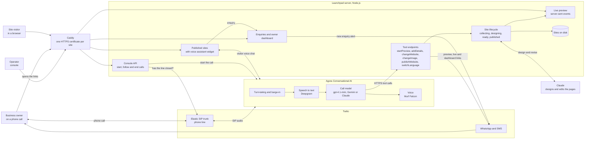
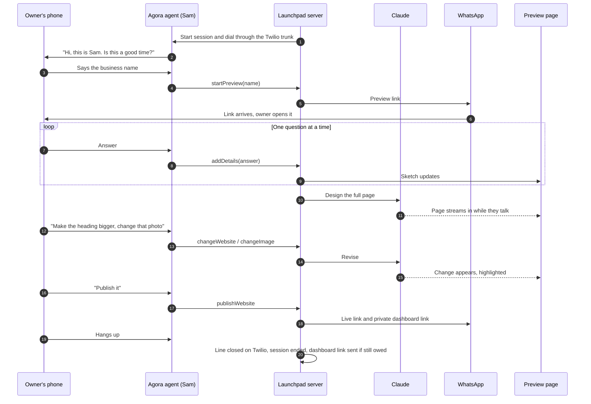

# Launchpad

An AI voice agent phones a small-business owner, interviews them, and builds their website
while they are still on the line. The owner gets a preview link on WhatsApp as soon as they say
the business name, asks for changes by voice and watches them appear, and says "publish" to go
live. Every published site comes with a voice assistant for visitors and a private dashboard for
the owner.

Built for the Build with Agora hackathon (Track 1: real-time conversational AI meets agentic
workflows).

## How a call goes

1. The operator enters a phone number in the console. Agora dials it through a Twilio SIP trunk.
2. Sam (the agent) asks for the business name. The moment it is said, a preview page exists at
   `https://<name>.<base-domain>/preview` and the link is sent by WhatsApp.
3. Sam asks one question at a time (what they do, who for, highlights, contact, style). Each
   answer is saved; when there is enough, Claude designs the full page and streams it into the
   open preview.
4. The owner asks for changes: wording, colours, sizes, sections, pictures. Each change is a tool
   call; the preview reloads and highlights what changed.
5. "Publish" puts the site live and sends two WhatsApp messages: the public link and a private
   dashboard link. If the call ends before publishing, the dashboard link is still sent so the
   owner can publish later.

The person can talk over the agent at any time (barge-in). English, Hindi and Tamil are
supported; asking to switch language ends the call and rings straight back in the new one.

## Architecture



What happens on one call:



## What does what

| Part | Role |
| --- | --- |
| Agora Conversational AI | Runs the call: listens, decides when the person has finished or interrupted, calls the model and our tools, speaks |
| Deepgram (through Agora) | Speech to text |
| Murf Falcon | The agent's voice, in each language |
| OpenAI `gpt-4.1-mini` (Agora managed), Gemini Flash or Claude | The model that talks on the call (`VOICE_LLM`) |
| Claude | Designs and edits the websites |
| Twilio | The phone line (Elastic SIP trunk) and WhatsApp messages |
| Caddy | One HTTPS certificate per site subdomain, issued on demand |

## Layout

```
server/            Node server, no framework
  index.mjs        operator console API (port 3210)
  public.mjs       public listener (port 3211): sites, previews, tool endpoints Agora calls
  phone.mjs        placing and following calls
  phone-agent.mjs  the agent's instructions and its tools
  sites.mjs        site lifecycle: collecting -> designing -> ready -> published
  site-designer.mjs  Claude prompts for designing and revising a page
  site-kit.mjs     behaviour added to every generated page
  crm.mjs, site-api.mjs, concierge.mjs   owner dashboard, enquiries, visitor voice assistant
  notify.mjs, whatsapp-templates.mjs     WhatsApp messages
public/            operator console (static)
site-kit/          owner dashboard, visitor widget, landing page, photo library
scripts/           provider checks, phone setup, WhatsApp template submission, deploy
deploy/            Caddyfile, systemd unit, server bootstrap
```

## Running it

Requires Node 22 or newer.

```bash
cp .env.example .env    # then fill in the keys; each one is explained in the file
npm install
npm run check           # confirms each provider answers
npm start               # console on http://localhost:3210
```

Phone calls need a Twilio number on an Elastic SIP trunk imported into Agora:

```bash
npm run phone:setup              # read-only plan
npm run phone:setup -- --apply   # create the trunk and import the number
```

Agora must be able to reach the tool endpoints over HTTPS, so calls that build websites need a
public address (`PUBLIC_URL`, `PUBLIC_HOST`). `deploy/bootstrap.sh` sets up a single server with
Caddy and `scripts/deploy.sh` ships the code to it.

WhatsApp messages use approved templates; `node scripts/whatsapp-templates.mjs --submit` creates
them and sends them to Meta for approval. Until a template is approved the same message goes by
SMS.

## Safety

- The console is password-protected and is the only place a call to an arbitrary number can be
  started. The public front page can only ring numbers enabled in the console.
- Tool endpoints require a bearer secret; generated pages are sanitised before they are served.
- No keys are in this repository. Everything secret lives in `.env`.

## Related

Thunai, a scheduled-call health companion for panchayats built on the same calling stack, lives
in its own repository. If its folder is placed at `care/`, this server mounts it under `/care`.
